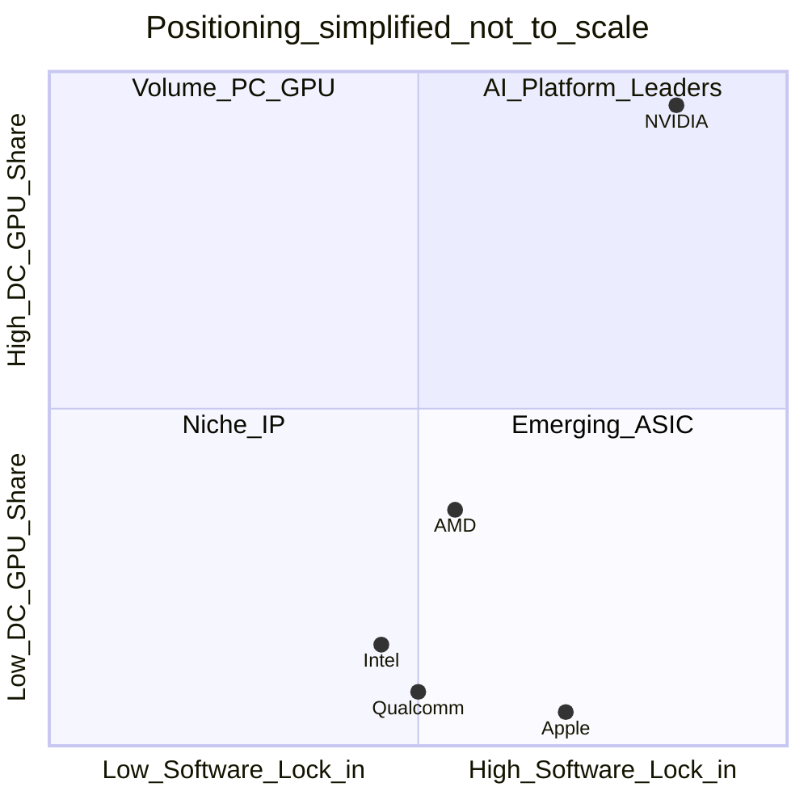

# بخش دوم: معرفی شرکت‌ها

**تاریخ به‌روزرسانی:** ۶ نوامبر ۲۰۲۶ (UTC+3:30)

---

## NVIDIA Corporation

| مورد | جزئیات |
|------|--------|
| **کشور/منطقه** | آمریکا (HQ: Santa Clara, California) |
| **سال تأسیس** | 1993 |
| **مدل کسب‌وکار** | طراح (fabless)؛ برند GeForce/Quadro/RTX؛ AIB توسط partners |
| **حوزه** | GPU مصرفی، دیتاسنتر AI/HPC، خودرو (Drive)، edge، نرم‌افزار (CUDA, AI Enterprise) |
| **بازارهای هدف** | گیمینگ، AI cloud، enterprise AI، HPC، Pro Viz، automotive |
| **معماری‌های اصلی** | Blackwell (DC/GeForce 50), Ada Lovelace, Hopper, Ampere؛ CUDA/Tensor/RT Cores |
| **محصولات کلیدی** | GeForce RTX 50, HGX B200/H200/H100, DGX, Drive Thor/Orin |
| **فناوری ساخت** | TSMC (N4/N5/N3 family per product generation) |
| **Foundry** | TSMC (اصلی) |
| **نقاط قوت** | اکوسystem CUDA، سهم واحد/درآمد AI، NVLink، نرم‌افزار ML |
| **نقاط ضعف** | وابستگی supply (CoWoS/HBM)، قیمت/دسترسی گیمینگ در رamping، lock-in CUDA |
| **مشتریان/شرکا** | AWS, Azure, GCP, OCI, Meta, OpenAI ecosystem؛ OEM سرور (Dell, Supermicro, …) |
| **وضعیت رقابتی** | پیشتاز **dGPU دسکتاپ (~92% AIB Q3'25)** و **GPU سرور (>90% unit Q4'24 IDC)** |
| **چشم‌انداز** | تمرکز Blackwell/ Rubin roadmap؛ گسترش networking (Spectrum-X)؛ رقابت ASIC cloud |

---

## Advanced Micro Devices (AMD)

| مورد | جزئیات |
|------|--------|
| **کشور** | آمریکا (HQ: Santa Clara) |
| **تأسیس** | 1969 |
| **مدل** | طراح fabless؛ CPU+GPU+APU؛ Instinct برای DC |
| **حوزه** | CPU x86, GPU RDNA/CDNA, APU, semi-custom (کنسول) |
| **بازارها** | PC گیمینگ/مصرفی، DC AI/HPC، کنسول، embedded |
| **معماری** | RDNA 4 (RX 9000), CDNA 3/4 (MI300/MI350), XDNA NPU روی APU |
| **محصولات** | Radeon RX 9070 XT/9070, Instinct MI325X/MI350X, Ryzen AI |
| **ساخت** | TSMC (CPU/GPU dies) |
| **Foundry** | TSMC |
| **قوت** | یکپارچگی CPU-GPU، ROCm بهبودیافته، قیمت/حافظه Instinct |
| **ضعف** | سهم AIB پایین (~7% Q3'25)، نرم‌افزار AI نسبت به CUDA، عرضه retail RDNA 4 |
| **شرکا** | Microsoft Azure (MI300), Meta, Dell/HPE سرور |
| **رقابت** | قوی در CPU؛ **دوم در DC GPU**؛ رقib گیمینگ با NVIDIA محدود |
| **چشم‌انداز** | CDNA yearly cadence؛ chiplet؛ رقابت inference با حافظه بالا |

---

## Intel Corporation

| مورد | جزئیات |
|------|--------|
| **کشور** | آمریکا (HQ: Santa Clara) |
| **تأسیس** | 1968 |
| **مدل** | طراح + **Intel Foundry** (IDM 2.0) |
| **حوزه** | CPU x86, GPU Xe, AI (Gaudi), foundry services |
| **بازارها** | PC (iGPU+dGPU Arc), DC (Gaudi, Xe HPC), edge |
| **معماری** | Xe2 (Battlemage Arc), Xe HPC (Ponte Vecchio/Falcon Shores roadmap), oneAPI |
| **محصولات** | Arc B580/B570, Core Ultra (Xe iGPU), Gaudi 3, Xeon |
| **ساخت** | Intel 4/3/18A (برخی GPU)؛ TSMC برای برخی tileها (محصول‌محور) |
| **Foundry** | Intel + TSMC (بسته به محصول) |
| **قوت** | حجم iGPU (~61% کل GPU PC units Q3'25)، کانال PC OEM، oneAPI |
| **ضعف** | Arc dGPU ~1% AIB؛ Gaudi سهم کوچک vs NVIDIA؛ execution foundry |
| **شرکا** | OEM PC، cloud برای Gaudi/Xeon |
| **رقابت** | **رهبر iGPU-via-CPU volume**؛ **بازیکن کوچک dGPU** |
| **چشم‌انداز** | Falcon Shores؛ foundry برای external customers |

---

## Apple Inc.

| مورد | جزئیات |
|------|--------|
| **کشور** | آمریکا (Cupertino) |
| **مدل** | طراح SoC یکپارچه (CPU+GPU+NPU)؛ fabless |
| **حوزه** | Mac, iPhone, iPad — GPU integrated |
| **معماری** | Apple GPU (Metal)، M-series, A-series |
| **محصولات** | M4/M4 Pro/Max, A18/A19 Pro |
| **ساخت** | TSMC (3nm/2nm roadmap) |
| **قوت** | بهره‌وری انرژی، Metal optimization، ~18% SoC موبایل 2025 |
| **ضعف** | بدون dGPU عمومی؛ CUDA/ROCm؛ gaming PC |
| **رقابت** | پیشرو **SoC premium** و Mac graphics efficiency |
| **چشم‌انداز** | GenAI on-device؛ 2nm SoC |

---

## Qualcomm Incorporated

| مورد | جزئیات |
|------|--------|
| **کشور** | آمریکا (San Diego) |
| **مدل** | طراح SoC (Adreno GPU + Hexagon NPU) |
| **حوزه** | موبایل، PC (Snapdragon X), automotive, edge |
| **معماری** | Adreno؛ Snapdragon 8 Elite Gen series |
| **محصولات** | Snapdragon 8 Elite, X Elite/Plus PC |
| **ساخت** | TSMC/Samsung (node per product) |
| **قوت** | ~25% SoC 2025؛ AI Orchestrator؛ PC ARM |
| **ضعف** | سهم GPU جداگانه منتشر نمی‌شود |
| **چشم‌انداز** | on-device GenAI؛ رقابت با MediaTek/Apple |

---

## ARM Holdings (GPU IP: Mali, Immortalis)

| مورد | جزئیات |
|------|--------|
| **کشور** | UK (SoftBank-owned; NASDAQ listed) |
| **مدل** | IP licensor — Mali/Immortalis GPU designs |
| **بازار** | موبایل، embedded، برخی Chromebook/IoT |
| **محصولات IP** | Immortalis-G925, Mali-G720 |
| **قوت** | حجم through MediaTek/Samsung/OEM |
| **ضعف** | بدون GPU merchant retail |
| **چشم‌انداز** | RT در Immortalis؛ ray tracing mobile |

---

## Imagination Technologies

| مورد | جزئیات |
|------|--------|
| **کشور** | UK |
| **مدل** | IP GPU (PowerVR) — automotive/embedded |
| **بازار** | خودرو، IoT، embedded |
| **قوت** | RT automotive GPU announcements |
| **ضعف** | سهم PC/DC negligible |
| **چشم‌انداز** | DRIVE competition via IP licensees |

---

## MediaTek Inc.

| مورد | جزئیات |
|------|--------|
| **کشور** | تایوان |
| **مدل** | طراح SoC (CPU Arm + GPU Arm Mali/Immortalis) |
| **بازار** | موبایل mid/high (Dimensity) |
| **قوت** | **~34.4% SoC 2025** (Counterpoint) |
| **ضعف** | GPU performance vs Apple/Qualcomm flagship |
| **چشم‌انداز** | Dimensity 9500 GenAI |

---

## Huawei — HiSilicon (Kirin)

| مورد | جزئیات |
|------|--------|
| **کشور** | چین |
| **مدل** | طراح SoC (CPU/GPU/NPU) — محدودیت صادرات تراشه |
| **بازار** | گوشی Huawei عمدتاً |
| **داده** | ~3–5% SoC global در جداول Counterpoint (2025–2026) |
| **ضعف** | دسترسی foundry پیشرفته؛ داده جهانی محدود |
| **چشم‌انداز** | domestic stack |

---

## Samsung Electronics (Exynos / Xclipse)

| مورد | جزئیات |
|------|--------|
| **کشور** | کره جنوبی |
| **مدل** | IDM + SoC (Xclipse GPU با AMD RDNA-derived IP در برخی نسل‌ها) |
| **بازار** | Galaxy، wearables |
| **SoC سهم** | ~5.7% (2025) Counterpoint |
| **چشم‌انداز** | Exynos 2600 (2nm claim 2025 PR ecosystem) |

---

## بازیگران چین (خلاصه — داده محدود)

| شرکت | یادداشت |
|------|---------|
| **Moore Threads** | GPU مصرفی/DC داخلی چین — سهم جهانی: **داده عمومی معتبر در دسترس نیست** |
| **Cambricon** | AI accelerator — عمدتاً domestic |
| **Biren / MetaX** | DC GPU startups — PR محلی |

---

## خلاصه موقعیت رقابتی (بدون ادغام متریک)

*نمودار بالا ** cualitative** است — بدون عدد سهم بازار.*
